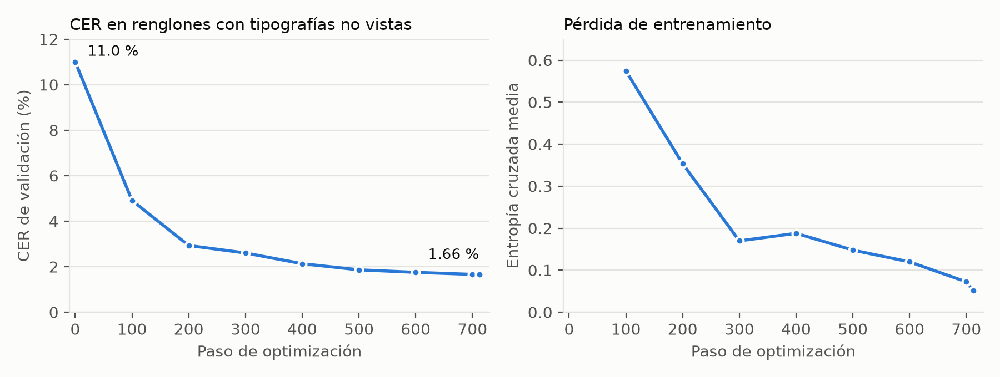

# Modelo de IA para manuscrito: CRAFT + TrOCR (local)

El reconocimiento de escritura a mano corre **en la máquina que procesa la
imagen** (un worker del clúster o, como respaldo, el coordinador). No se manda
la imagen a ningún servicio externo. El modelo de visión remoto (Groq) queda
solo como punto de comparación en el benchmark (`HANDWRITING_ENGINE=groq`).

| Etapa | Modelo | Archivo | Pesos |
|---|---|---|---|
| Detección de texto y segmentación en renglones | CRAFT (`craft_mlt_25k.pth`) | `app/trocr_engine.py` → `segment()` | Locales, incluidos en el repositorio |
| Reconocimiento de cada renglón | TrOCR `microsoft/trocr-base-handwritten` | `app/trocr_engine.py` → `recognize_lines()` | Se descargan una vez (1.1 GB) a `app/models/trocr/` |
| Respaldo si TrOCR falla | EasyOCR (CRAFT + CRNN/CTC) | `app/ocr_engine.py` | Locales |

## 1. Planteamiento

Dada la imagen de un renglón $x$, el sistema busca la secuencia de tokens
$\hat{y} = (\hat{y}_1, \dots, \hat{y}_T)$ más probable:

$$\hat{y} = \arg\max_{y} P(y \mid x) = \arg\max_{y} \prod_{t=1}^{T} P(y_t \mid y_{<t}, x)$$

TrOCR modela $P(y_t \mid y_{<t}, x)$ con un Transformer codificador-decodificador:
el codificador "mira" la imagen y el decodificador escribe el texto un token a la vez.

## 2. Segmentación de la página (CRAFT)

TrOCR reconoce un renglón por imagen, así que la página se divide primero:

1. **CRAFT** produce dos mapas de calor del tamaño de la imagen: *region score*
   (probabilidad de que un píxel sea el centro de un carácter) y *affinity score*
   (probabilidad de que esté entre dos caracteres de la misma palabra).
   Umbralizando ambos (`text_threshold=0.6`, `low_text=0.3`, `link_threshold=0.3`)
   se obtienen las cajas de las palabras.
2. **Agrupación en renglones** (`group_lines`): las cajas se recorren de arriba
   abajo y una caja $b$ se une al renglón $r$ con mayor solapamiento vertical si

$$\text{ov}(b, r) = \frac{\max\big(0,\ \min(y_1^b, y_1^r) - \max(y_0^b, y_0^r)\big)}{\min(h_b,\ h_r)} \ \ge\ 0.5$$

   de lo contrario abre un renglón nuevo. Dividir entre la altura **menor** evita
   que una mayúscula o una letra alta que toca el renglón vecino los una.
3. Cada renglón se recorta a todo el ancho de la imagen, con 6 px de margen vertical,
   para no perder palabras cortas que CRAFT no detectó.

## 3. Codificador (Vision Transformer)

Parámetros reales del modelo usado (de su `config.json`):

| | Codificador (ViT) | Decodificador (TrOCR) |
|---|---|---|
| Capas | 12 | 12 |
| Dimensión oculta $d$ | 768 | 1024 |
| Cabezas de atención | 12 | 16 |
| Capa feed-forward | 3072 | 4096 |
| Entrada / vocabulario | imagen 384×384, parches 16×16 | 50 265 tokens BPE |
| Parámetros totales | 334 M | |

1. El renglón se redimensiona a $384 \times 384$ y se normaliza.
2. Se divide en $N = (384/16)^2 = 576$ parches $p_i \in \mathbb{R}^{16 \cdot 16 \cdot 3}$.
3. Cada parche se proyecta linealmente y se le suma su posición:
   $z_0 = [\,E p_1;\ \dots;\ E p_N\,] + E_{pos}$, con $E \in \mathbb{R}^{768 \times 768}$.
4. Cada una de las 12 capas aplica atención y una red feed-forward con conexiones residuales:

$$z'_\ell = z_{\ell-1} + \text{MHSA}\big(\text{LN}(z_{\ell-1})\big), \qquad
z_\ell = z'_\ell + \text{FFN}\big(\text{LN}(z'_\ell)\big)$$

La atención de cada cabeza es

$$\text{Attention}(Q, K, V) = \text{softmax}\!\left(\frac{Q K^\top}{\sqrt{d_k}}\right) V,
\qquad Q = zW_Q,\ K = zW_K,\ V = zW_V$$

y relaciona cada parche con todos los demás: así un trazo ambiguo se interpreta
según los trazos vecinos de la misma palabra.

## 4. Decodificador y generación del texto

El decodificador recibe los tokens ya generados $y_{<t}$ y en cada capa aplica:

1. **Autoatención enmascarada:** cada token solo ve a los anteriores.
2. **Atención cruzada:** $Q$ sale del texto y $K, V$ de la salida del codificador,
   así cada token "busca" en la imagen la zona que le corresponde.
3. **Feed-forward.**

La última capa da una distribución sobre el vocabulario:

$$P(y_t \mid y_{<t}, x) = \text{softmax}(W_o h_t)$$

**Inferencia:** búsqueda voraz, $\hat{y}_t = \arg\max P(y_t \mid \hat{y}_{<t}, x)$,
hasta el token de fin o 96 tokens. Con 4 haces (*beam search*) el CER fue el
mismo en las pruebas y tardaba más del doble, así que el valor por defecto es 1
(`TROCR_BEAMS`).

**Confianza por renglón:** el sistema calcula la log-probabilidad media por token

$$\bar{\ell} = \frac{1}{T} \sum_{t=1}^{T} \log P(\hat{y}_t \mid \hat{y}_{<t}, x)$$

Cerca de 0 significa que el modelo está seguro; valores muy negativos marcan
renglones que conviene revisar a mano.

## 5. Entrenamiento del modelo

El modelo no se entrenó en este proyecto: se usan los pesos publicados por
Microsoft [Li et al., 2023], preentrenados con texto impreso sintético y
afinados con la base IAM de manuscrito en inglés, minimizando la entropía cruzada

$$\mathcal{L} = -\sum_{t=1}^{T} \log P(y_t \mid y_{<t}, x)$$

Comparación con el modelo de EasyOCR (CRNN), que se entrena con CTC: la red
emite una etiqueta por columna de la imagen (o un "blanco") y la pérdida suma
todas las alineaciones $\pi$ que colapsan al texto correcto:

$$\mathcal{L}_{CTC} = -\log \sum_{\pi \in \mathcal{B}^{-1}(y)} \prod_{t} P(\pi_t \mid x)$$

CTC decide cada carácter de forma independiente. El decodificador de TrOCR, en
cambio, condiciona cada token a los anteriores; funciona como un modelo de
lenguaje y por eso tolera mejor las letras unidas de la escritura a mano.

## 6. Validación

Se usa el mismo protocolo que con los demás motores (`benchmark/evaluar.py`):

- CER y WER con distancia de Levenshtein, sumando errores de todo el corpus.
- Intervalo de confianza del 95 % por *bootstrap* (1000 remuestreos, semilla 42).
- Mismos bytes de imagen, mismo equipo y misma normalización para todos los motores.

**Advertencia sobre IAM:** `trocr-base-handwritten` se afinó con IAM, así que
sus cifras en IAM son optimistas: algunas de las 150 líneas pueden estar en su
conjunto de entrenamiento. La prueba que no tiene ese sesgo es el conjunto propio
en español (`benchmark/datasets/es_manuscrito`), que aún falta fotografiar.

## 7. Resultados

### IAM, 150 líneas manuscritas en inglés (misma PC, solo CPU)

| Motor | Dónde corre | CER (IC 95 %) | WER (IC 95 %) | CER estricto | WER estricto | Tiempo medio | p95 |
|---|---|---|---|---|---|---|---|
| Tesseract 5.5 | Local | 50.9 % (46.3–55.4) | 87.9 % (83.0–93.0) | 54.9 % | 93.0 % | 619 ms | 935 ms |
| EasyOCR 1.7.2 | Local | 46.0 % (43.4–48.4) | 102.3 % (98.3–106.4) | 50.9 % | 110.1 % | 1879 ms | 3130 ms |
| **TrOCR base (este proyecto)** | **Local** | **1.4 % (0.8–2.1)** | **3.5 % (2.3–4.8)** | **1.8 %** | **6.4 %** | 3199 ms | 4384 ms |
| Qwen vía Groq (comparación) | Nube | 2.6 % (1.8–3.3) | 6.4 % (4.8–8.1) | 4.5 % | 11.4 % | 17 669 ms* | 71 053 ms* |

CER/WER con normalización flexible (minúsculas, sin puntuación); "estricto"
conserva mayúsculas y signos. (*) Incluye esperas por el límite de la cuota
gratuita de Groq.

Lectura honesta: en IAM, TrOCR local supera al modelo remoto y es unas 35 veces
más preciso por carácter que Tesseract. Hay que recordar que TrOCR se afinó
con IAM, así que esta cifra es optimista (sección 6).

La primera corrida dio WER estricto de 26.3 %: el modelo separa la puntuación
como en las transcripciones de IAM ("Monday . Once"). Se agregó `detokenize()`,
que pega los signos a la palabra, y bajó a 6.4 % sin cambiar el CER flexible.

### Página en español, cursiva (`manuscrita.jpg`, 4 renglones)

| Motor | CER | WER | Tiempo |
|---|---|---|---|
| EasyOCR | 34.4 % | 95.5 % | — |
| TrOCR base | 17.6 % | 63.6 % | 16 s (4 renglones) |

La segmentación encontró bien los 4 renglones, pero el modelo, entrenado en
inglés, no conoce el vocabulario ni los acentos del español: "Había una vez"
salió "Alabama una vez". La confianza $\bar{\ell}$ de esos renglones fue de
−2.3 a −2.5, contra −0.002 en las líneas de IAM; o sea, el sistema sí detecta
que esos renglones son dudosos.

**Siguiente paso:** afinar TrOCR con manuscrito en español (*fine-tuning*),
usando el conjunto propio dividido por escritor: unos para entrenar y otros,
que el modelo nunca vio, para medir.

## 8. Afinado en español con renglones sintéticos

El error principal en español es de **idioma**, no de forma de la letra: el
decodificador nunca vio palabras como "había" o "querían". Para enseñárselas se
generan renglones sintéticos y se afina el modelo.

### Datos (`entrenamiento/generar_sintetico.py`)

| Elemento | Detalle |
|---|---|
| Texto | 545 mil palabras de obras de dominio público: *Don Quijote* (Cervantes), *Marianela* y *Doña Perfecta* (Pérez Galdós), de Project Gutenberg. Se agregan frases con fechas, cantidades y números (6 %). |
| Exclusión | Se descarta cualquier renglón que comparta 4 palabras seguidas con las hojas de prueba, para no evaluar con texto visto. |
| Letra | 41 tipografías manuscritas de Google Fonts (licencias OFL/Apache) que incluyen á é í ó ú ü ñ ¿ ¡. Se dibuja palabra por palabra, con espacio y altura variables. |
| Degradación | Inclinación de la letra (−0.35 a 0.25), rotación (±2°), ondulación del renglón, trazo más grueso o fino, tinta negra/azul/gris, papel blanco a crema, renglón de cuaderno, sombra de luz desigual, ruido, desenfoque, baja resolución y compresión JPEG (calidad 55–95). |
| Tamaño | 6000 renglones: 5700 de entrenamiento y 300 de validación. |
| Validación | Los renglones de validación usan **5 tipografías que el entrenamiento no ve**, así se mide si el modelo generaliza a otra letra y no si memorizó una tipografía. |

### Entrenamiento (`entrenamiento/afinar_trocr.py`)

- Se parte de `microsoft/trocr-base-handwritten`.
- Se minimiza la entropía cruzada de la sección 5. La pérdida se calcula en el
  script: en transformers 4.57, pasar `labels=` al modelo vuelve a desplazar las
  etiquetas y la pérdida sale desalineada (16.4 en vez de 0.29 con el modelo sin entrenar).
- Las etiquetas van **sin** el token `<s>` inicial, porque el modelo publicado
  genera `</s>` seguido directamente del texto.
- **Codificador congelado:** se entrenan solo el decodificador y la atención
  cruzada (247 M de 334 M parámetros). El codificador ya sabe ver trazos; lo
  que hay que ajustar es el idioma. Así cada paso es más rápido en CPU.
- AdamW, tasa de aprendizaje 3·10⁻⁵ con calentamiento lineal (5 %) y decaimiento
  lineal, lote 8 con 2 pasos acumulados (efectivo 16), recorte de gradiente a 1.0, 2 épocas.
- Se evalúa el CER de validación cada 100 pasos y se guarda solo el mejor modelo
  en `app/models/trocr-es/`. El historial queda en `historial.csv`.
- En cada evaluación también se guarda el punto actual (`ultimo/` y `estado.json`).
  Si el proceso se corta, `--reanudar` sigue desde ahí. Para detenerlo de forma
  ordenada se crea un archivo vacío `DETENER` en la carpeta de salida.

Prueba corta (108 renglones, 12 pasos): el CER de validación bajó de 5.5 % a
3.0 %. Eso confirma que el entrenamiento funciona.

### Resultados del afinado

Entrenamiento completo: 712 pasos (2 épocas), 3.1 horas de cómputo en la CPU de la PC del autor.

| Paso | 0 | 100 | 200 | 300 | 400 | 500 | 600 | 700 | 712 |
|---|---|---|---|---|---|---|---|---|---|
| CER validación (tipografías no vistas) | 11.0 % | 4.9 % | 2.9 % | 2.6 % | 2.1 % | 1.9 % | 1.75 % | **1.66 %** | 1.66 % |
| Pérdida media | — | 0.57 | 0.35 | 0.17 | 0.19 | 0.15 | 0.12 | 0.07 | 0.05 |

El CER de validación bajó en cada evaluación, sin repuntes, y los renglones de
validación usan tipografías que el entrenamiento no vio. Eso indica que el
modelo aprendió el idioma y no memorizó los ejemplos.

**Página real en español, cursiva** (`manuscrita.jpg`, nunca usada para entrenar):

| Modelo | CER | WER | Renglón 1 | Renglón 3 |
|---|---|---|---|---|
| TrOCR original | 17.6 % | 63.6 % | " Alabama una vez tresparditos que... | muchory siemprese ayidaban entre. |
| **TrOCR afinado** | **8.0 %** | **31.8 %** | ¡Había una vez tres carditos que... | mucho y siempre se ayúdaban entre |

**IAM, 150 líneas en inglés** (para ver cuánto se pierde del idioma original):

| Modelo | CER (IC 95 %) | WER (IC 95 %) | Tiempo medio |
|---|---|---|---|
| TrOCR original | 1.4 % (0.8–2.1) | 3.5 % (2.3–4.8) | 3.2 s |
| TrOCR afinado | 3.1 % (2.4–3.9) | 8.5 % (6.7–10.4) | 4.2 s |
| Qwen vía Groq (nube) | 2.6 % (1.8–3.3) | 6.4 % (4.8–8.1) | — |
| Tesseract 5.5 | 50.9 % | 87.9 % | 0.6 s |

Lectura: el afinado redujo a menos de la mitad los errores en español y, a
cambio, perdió algo de exactitud en inglés. Es el efecto esperado al adaptar
un modelo a otro idioma (olvido parcial). Aun así sigue en el mismo rango que el
modelo remoto y es 16 veces más preciso por carácter que Tesseract. Como el
sistema está acotado al español (sección I.A del documento), el modelo afinado
es el que se usa por defecto.

Limitaciones:
- La página en español es una sola muestra de 4 renglones. La cifra definitiva
  saldrá del conjunto propio de varios escritores (`benchmark/datasets/es_manuscrito`).
- Los tiempos en IAM no son comparables entre sí: durante la medición del modelo
  afinado había otros procesos usando la CPU.
- Mejora posible: mezclar renglones reales (SPA-Sentences o el conjunto propio)
  con los sintéticos, y renglones en inglés para reducir el olvido.

**Cómo se usa:** si existe `BACKEND/app/models/trocr-es/`, el sistema lo carga
automáticamente. `TROCR_MODEL` en `.env` fuerza otro modelo. La carpeta pesa
1.3 GB y no se sube al repositorio; para los workers en otras computadoras se
copia la carpeta o se vuelve a entrenar con `entrenamiento/entrenar.ps1`.

## Referencias

- M. Li et al., "TrOCR: Transformer-based optical character recognition with pre-trained models," AAAI, 2023.
- Y. Baek et al., "Character region awareness for text detection," CVPR, 2019.
- A. Dosovitskiy et al., "An image is worth 16x16 words: Transformers for image recognition at scale," ICLR, 2021.
- A. Vaswani et al., "Attention is all you need," NeurIPS, 2017.
- A. Graves et al., "Connectionist temporal classification," ICML, 2006.
