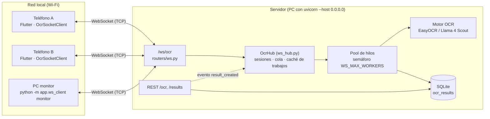
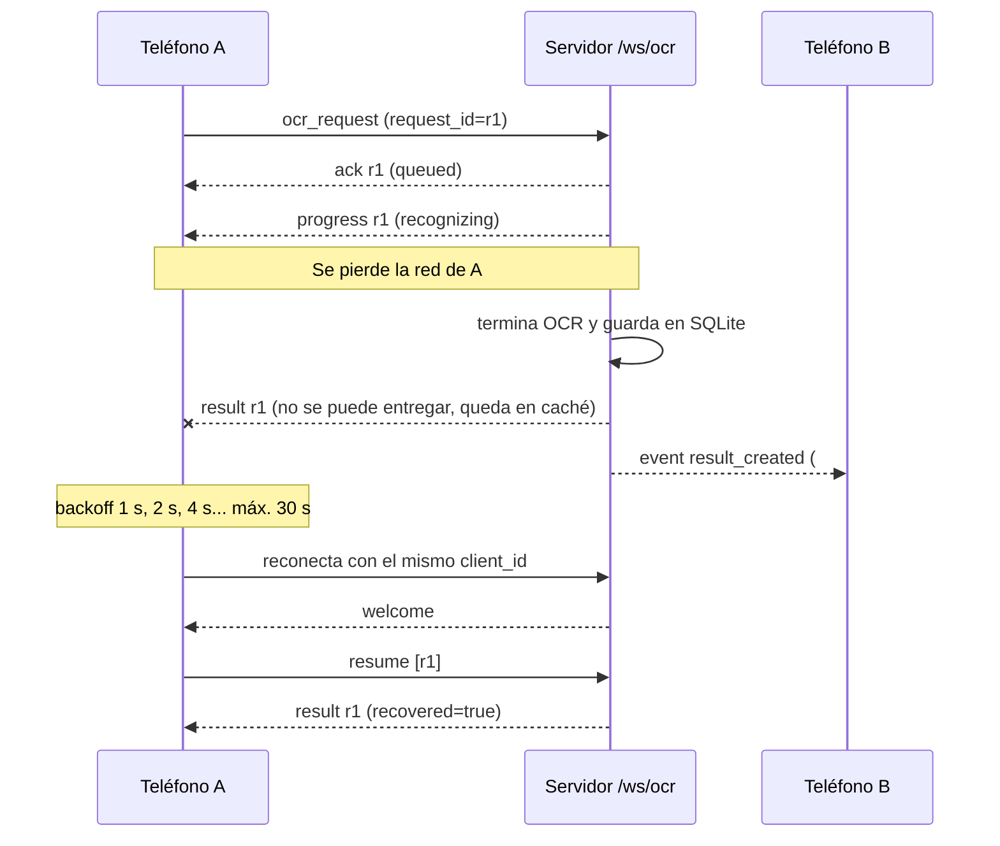

# Comunicación distribuida por WebSocket

Este documento describe el canal de sockets entre la app Flutter (uno o varios
dispositivos) y el backend FastAPI, el formato de los mensajes, el manejo de
concurrencia, desconexiones y errores, y cómo demostrarlo con dispositivos
independientes.

## 1. Arquitectura



| Componente | Archivo | Responsabilidad |
|---|---|---|
| Endpoint WebSocket | `BACKEND/app/routers/ws.py` | Acepta conexiones, valida y despacha mensajes, ejecuta los trabajos OCR |
| Hub de conexiones | `BACKEND/app/ws_hub.py` | Registro de sesiones por `client_id`, presencia, difusión de eventos, cola y caché de trabajos |
| Persistencia | `BACKEND/app/models.py` | Columnas `request_id` y `client_id` en `ocr_results` para recuperar resultados |
| Cliente Flutter | `flutter_ocr_app/lib/core/socket_client.dart` | Conexión, heartbeat, reconexión con backoff, reenvío y recuperación de solicitudes |
| Pantalla En vivo | `flutter_ocr_app/lib/screens/live_screen.dart` | Estado del canal, dispositivos en línea, resultados de otros dispositivos, bitácora |
| Cliente de consola | `BACKEND/app/ws_client.py` | Monitor, envío y prueba de carga desde una PC |
| Pruebas | `BACKEND/tests/test_ws.py`, `flutter_ocr_app/test/socket_client_test.dart` | Flujo, concurrencia, errores, desconexión y recuperación |

## 2. Conexión

```
ws://<IP_DEL_SERVIDOR>:8000/ws/ocr?client_id=<id>&device=<nombre>
```

- `client_id`: identificador estable del dispositivo (la app lo genera una vez y lo guarda en
  `SharedPreferences`, p. ej. `app-3fa9c1d2e4b0`). Identifica a quién pertenece cada solicitud y a qué
  conexión se entrega el resultado, incluso después de reconectar.
- `device`: nombre visible (configurable en Ajustes).
- Todos los mensajes son **texto JSON** con un campo `type`. Las imágenes viajan en base64 dentro del JSON.

## 3. Mensajes

### Cliente → servidor

| `type` | Campos | Uso |
|---|---|---|
| `ocr_request` | `request_id`, `image_b64`, `filename`, `lang` (`"es,en"`), `mode` (`"handwriting"` o `""`), `doc_type_id` | Envía una imagen a procesar |
| `resume` | `request_ids: [..]` | Tras reconectar, pide el estado o resultado de solicitudes previas |
| `ping` | `ts` (ms) | Heartbeat de aplicación; el servidor responde `pong` con el mismo `ts` (RTT) |
| `list_clients` | — | Pide la lista de dispositivos conectados |

### Servidor → cliente

| `type` | Campos | Cuándo |
|---|---|---|
| `welcome` | `protocol_version`, `session_id`, `client_id`, `clients_online`, `max_image_mb`, `idle_timeout_s` | Al conectar |
| `ack` | `request_id`, `status` (`queued`/`processing`), `queue_position`, `bytes`, `format` | Solicitud aceptada y encolada |
| `progress` | `request_id`, `stage` (`recognizing`, `saving`) | Avance del procesamiento |
| `result` | `request_id`, `elapsed_ms`, `result` (mismo esquema que `POST /ocr`), `recovered` | Resultado final |
| `error` | `code`, `message`, `request_id` (si aplica) | Ver tabla de errores |
| `event` | `event: "result_created"`, `origin_client_id`, `via` (`websocket`/`rest`), `result` | Difusión a los **demás** dispositivos |
| `presence` | `clients_online`, `clients: [{client_id, device, session_id, connected_at}]` | Cada vez que alguien se conecta o desconecta |
| `pong` | `ts`, `server_time` | Respuesta a `ping` |

### Ejemplo de intercambio

```json
→ {"type":"ocr_request","request_id":"9f2c1a7b5e3d4c10","filename":"nota.jpg","lang":"es,en","mode":"handwriting","doc_type_id":null,"image_b64":"/9j/4AAQ..."}
← {"type":"ack","request_id":"9f2c1a7b5e3d4c10","status":"queued","queue_position":0,"bytes":89522,"format":"jpeg"}
← {"type":"progress","request_id":"9f2c1a7b5e3d4c10","stage":"recognizing"}
← {"type":"progress","request_id":"9f2c1a7b5e3d4c10","stage":"saving"}
← {"type":"result","request_id":"9f2c1a7b5e3d4c10","elapsed_ms":2310.4,"result":{"id":42,"filename":"nota.jpg","estatus":"Procesado","text":"Había una vez...","created_at":"2026-10-18T16:28:51","doc_type_id":null,"engine":"groq","request_id":"9f2c1a7b5e3d4c10","client_id":"app-3fa9c1d2e4b0"}}
```

Los demás dispositivos conectados reciben al mismo tiempo:

```json
← {"type":"event","event":"result_created","origin_client_id":"app-3fa9c1d2e4b0","via":"websocket","result":{"id":42,...}}
```

### Secuencia con caída de red



## 4. Concurrencia

- Cada conexión se atiende en su propia corrutina; el bucle de recepción **no se bloquea** mientras se
  procesa una imagen, así que un mismo dispositivo puede tener varias solicitudes en curso.
- El OCR (CPU) se ejecuta en un pool de hilos (`asyncio.to_thread`) limitado por un semáforo de
  `WS_MAX_WORKERS` trabajos simultáneos (por defecto 2). El resto espera en cola y el `ack` reporta su
  `queue_position`.
- Si hay más de `WS_MAX_WORKERS + WS_MAX_QUEUE` (2 + 20) trabajos pendientes, el servidor responde
  `BUSY` con `retry_after_seconds`; la app reintenta sola.
- Los envíos a cada socket se serializan con un candado por conexión, para que los resultados de trabajos
  paralelos no se mezclen.
- `POST /ocr` también pasó a ejecutar el OCR en un hilo, para no bloquear a los clientes WebSocket.

Prueba medida (servidor con OCR simulado de 1.5 s, 4 clientes simultáneos, `WS_MAX_WORKERS=2`): los
dos primeros terminaron a los ~1.5 s y los dos siguientes, que esperaron en cola (posiciones 1 y 2), a
los ~3.0 s. Total 3.1 s frente a 6 s si fuera secuencial.

## 5. Desconexiones

| Situación | Detección | Comportamiento |
|---|---|---|
| Cierre normal | Frame de cierre (1000) | Se elimina la sesión y se difunde `presence` |
| Caída de red / app cerrada a la fuerza | Ping de protocolo de uvicorn (20 s) y `ping` de aplicación cada 15 s; sin `pong` en 10 s la app da la conexión por perdida | La app reconecta con backoff exponencial 1, 2, 4, 8, 16, 30 s |
| Resultado listo con el cliente desconectado | `deliver()` no encuentra conexión | El resultado queda en la caché del hub (500 últimos) y en SQLite con su `request_id` |
| Reconexión | `welcome` | La app envía `resume` con las solicitudes ya aceptadas y reenvía las que nunca llegaron a confirmarse |
| Servidor reiniciado | `resume` no encuentra el trabajo en memoria | Se busca en SQLite por `request_id` + `client_id`; si no existe responde `NOT_FOUND` y la app reenvía la imagen |
| Mismo `client_id` abierto dos veces | `register()` | La sesión vieja recibe `SESSION_REPLACED` y se cierra con código 4001 |
| Inactividad | Sin mensajes en `WS_IDLE_TIMEOUT` (90 s) | El servidor cierra con código 4002 |

Las solicitudes son **idempotentes**: reenviar un `ocr_request` con un `request_id` ya conocido no lo
procesa dos veces, devuelve su estado o resultado actual.

## 6. Errores

| `code` | Causa |
|---|---|
| `INVALID_JSON` | El mensaje no es JSON o no es un objeto |
| `UNKNOWN_TYPE` | `type` desconocido |
| `UNSUPPORTED_FRAME` | Se envió un frame binario |
| `INVALID_REQUEST` | Falta `request_id` o `image_b64`, o tienen formato inválido |
| `INVALID_IMAGE` | `image_b64` no es base64 válido |
| `UNSUPPORTED_FORMAT` | Los bytes no son PNG, JPEG, WEBP ni PDF (se valida por firma, no por extensión) |
| `TOO_LARGE` | Imagen mayor a `WS_MAX_IMAGE_MB` (10 MB) |
| `BUSY` | Cola llena; incluye `retry_after_seconds` |
| `OCR_FAILED` | El motor falló; el intento queda guardado con estatus `Error: ...` |
| `DUPLICATE_REQUEST` | Otro cliente ya usó ese `request_id` |
| `NOT_FOUND` | `resume` de una solicitud desconocida |
| `SESSION_REPLACED`, `IDLE_TIMEOUT`, `INTERNAL` | Ver sección 5 |

## 7. Variables de entorno

| Variable | Defecto | Uso |
|---|---|---|
| `WS_MAX_WORKERS` | 2 | Trabajos OCR simultáneos |
| `WS_MAX_QUEUE` | 20 | Trabajos en espera antes de responder `BUSY` |
| `WS_MAX_IMAGE_MB` | 10 | Tamaño máximo de imagen por socket |
| `WS_IDLE_TIMEOUT` | 90 | Segundos sin mensajes antes de cerrar |

`GET /health` incluye un bloque `websocket` con clientes en línea y trabajos pendientes, procesados y
fallidos.

## 8. Cómo demostrarlo con dispositivos independientes

1. **Servidor (PC)**. Conectar la PC y los teléfonos a la misma red Wi-Fi y arrancar el backend
   escuchando en todas las interfaces:
   ```
   cd BACKEND
   uvicorn app.main:app --host 0.0.0.0 --port 8000
   ```
   Obtener la IP de la PC con `ipconfig` (p. ej. `192.168.1.50`). En Windows, permitir Python en el
   firewall para redes privadas cuando lo pregunte.
2. **Teléfono A y Teléfono B**. Instalar la app en dos teléfonos (o un teléfono y el emulador). En
   *Ajustes* poner `http://192.168.1.50:8000` como URL del API, darle un nombre distinto a cada uno
   ("Teléfono A", "Teléfono B") y pulsar *Probar conexión*.
3. **Presencia**. Abrir la pestaña *En vivo* en ambos: cada uno muestra "Conectado" y la lista con los
   dos dispositivos.
4. **Comunicación entre dispositivos**. En el Teléfono A, *Capturar* con "Enviar por WebSocket"
   activado: el botón muestra las etapas (En cola, Reconociendo texto, Guardando). Al terminar, el
   resultado aparece al instante en *En vivo → Resultados de otros dispositivos* del Teléfono B.
5. **Monitor en la PC** (opcional, tercer nodo):
   ```
   python -m app.ws_client monitor --url ws://192.168.1.50:8000/ws/ocr
   ```
   Imprime en vivo la presencia y cada resultado creado.
6. **Desconexión**. En el Teléfono A enviar una imagen y, mientras procesa, pulsar *Simular caída* (o
   activar el modo avión unos segundos). La pestaña *En vivo* muestra "Reconectando · próximo intento
   en N s"; al volver la red se reconecta solo, envía `resume` y entrega el resultado. La bitácora del
   protocolo muestra cada paso.
7. **Concurrencia**. Enviar desde ambos teléfonos a la vez, o desde la PC:
   ```
   python -m app.ws_client stress ../manuscrita.jpg -n 6 --url ws://192.168.1.50:8000/ws/ocr
   ```
   La salida muestra las posiciones en cola y el tiempo total; el log del servidor muestra cada
   conexión y desconexión con su `client_id` e IP.
8. **Errores**. Apagar el servidor con la app abierta: la app pasa a "Reconectando" con backoff, y al
   levantarlo de nuevo se reconecta sin intervención.

## 9. Pruebas automatizadas

```
cd BACKEND
pip install pytest httpx
python -m pytest -q tests          # 9 pruebas: flujo, difusión, concurrencia, errores,
                                   # recuperación tras desconexión y tras reinicio, idempotencia
cd ../flutter_ocr_app
flutter test                       # WS_TEST_URL=http://<ip>:8000 flutter test  (prueba contra el backend real)
```

## 10. Limitaciones

- Las imágenes viajan en base64 (≈33 % más bytes que binario) para mantener un protocolo de solo texto
  fácil de inspeccionar.
- La caché de trabajos vive en memoria de un solo proceso; con varios workers de uvicorn cada uno tendría
  su propio hub (la recuperación desde SQLite sí funciona entre procesos).
- Sin autenticación ni TLS en la red local; para Internet habría que usar `wss://` detrás de un proxy y
  un token por dispositivo.
